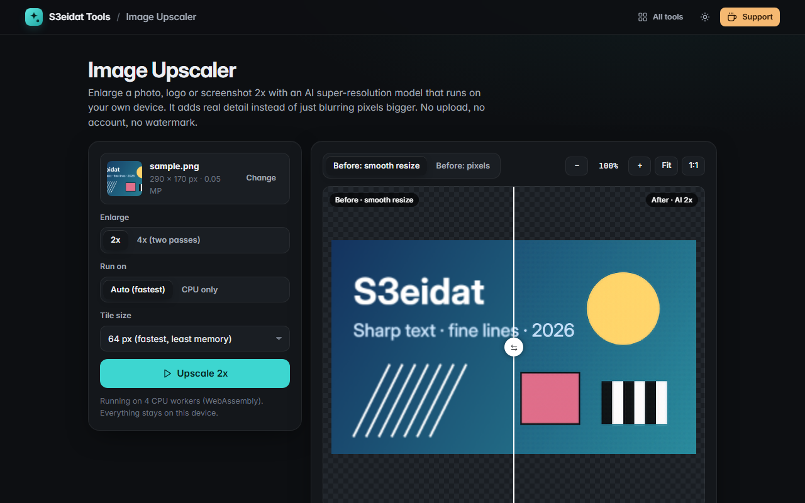

# Image Upscaler

> Enlarge images 2x (or 4x) with an AI super-resolution model. Free, private, and it runs entirely in your browser.

### ▶ [Open Image Upscaler](https://s3eidat.github.io/image-upscale/)



## Features

- **AI 2x upscaling** with Swin2SR (classical SR x2). It rebuilds edges and text instead of just blurring pixels bigger
- **4x** by running the model twice (it warns you first: the second pass works on a 4x larger image, so 4x takes about 5x as long as 2x)
- **Tiled processing**: the image is cut into overlapping tiles (64 px by default, 16 px overlap) and the seams are feather-blended, so memory stays low
- **Parallel workers**: the model runs in up to 4 Web Workers at once, one tile each, so the page never freezes
- **Progress, time left and Cancel** at any point
- **Before/after slider** at actual size (1:1), with zoom, pan, pinch and keyboard control. "Before" is a normal smooth resize or the raw pixels, so you can see exactly what the AI added
- **Download PNG** at the full new size. Transparency is kept (the alpha channel is enlarged smoothly)
- Clear size limit: up to **1 megapixel** in (e.g. 1000×1000 → 2000×2000) for 2x, 0.25 MP for 4x, with a one-click "shrink to fit"
- Open, drop or paste an image; your settings are remembered

## How fast is it?

It is a big model running on your own device, so it is slower than a cloud service: on a 6-core desktop CPU
it takes about **9–10 minutes per input megapixel** at 2x with 4 workers (a 500×500 image is about 2.5 minutes).
Phones and older laptops are slower. The page shows an estimate before you start and learns your device's real
speed after the first run.

**WebGPU:** when your browser has WebGPU, the page runs the same test tile on the GPU and on the CPU. It keeps the GPU
only if its output matches the CPU's and it is faster. The bundled model is 8-bit quantized; with it, many GPUs hand
the integer maths back to the CPU (slower) or return slightly different numbers, so on most machines the CPU workers win.
"CPU only" skips the test.

## Privacy

Your images never leave your device. There is no server, no account, no analytics. The model (21 MB) and the
WebAssembly runtime ship with the page and load from it: the model hub and CDNs are switched off
(`allowRemoteModels = false`, local model path, local wasm path). The page has a strict Content-Security-Policy
(`connect-src 'self'`), so the browser itself blocks any attempt to send data anywhere. The policy allows compiling
WebAssembly (`'wasm-unsafe-eval'`) but not JavaScript `eval`.

## Run it yourself

It's plain HTML, CSS and JavaScript with no build step:

```bash
git clone https://github.com/s3eidat/image-upscale
cd image-upscale
python -m http.server 8000
```

Then open http://localhost:8000.

## Credits

- **Swin2SR**: Marcos V. Conde, Ui-Jin Choi, Maxime Burchi, Radu Timofte, *Swin2SR: SwinV2 Transformer for Compressed Image
  Super-Resolution and Restoration* (ECCV 2022 workshops). Weights `caidas/swin2SR-classical-sr-x2-64`, ONNX export
  `Xenova/swin2SR-classical-sr-x2-64` (8-bit quantized), Apache-2.0. See `models/LICENSES.md`.
- **[Transformers.js](https://github.com/huggingface/transformers.js)** 3.2.4 by Hugging Face, Apache-2.0 (`lib/transformers.LICENSE`).
- **[ONNX Runtime Web](https://github.com/microsoft/onnxruntime)** by Microsoft, MIT (`lib/ort.LICENSE`).

## Support

If this saved you time, **[buy me a coffee ☕](https://s3eidat.github.io/coffee/)**. It keeps every tool free.

---

Part of **[S3eidat Tools](https://s3eidat.github.io/)**: 100+ free, private tools that run in your browser. MIT licensed (the model and libraries keep their own licences).
